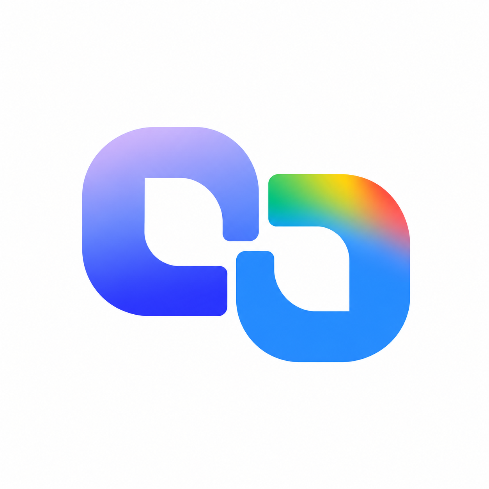
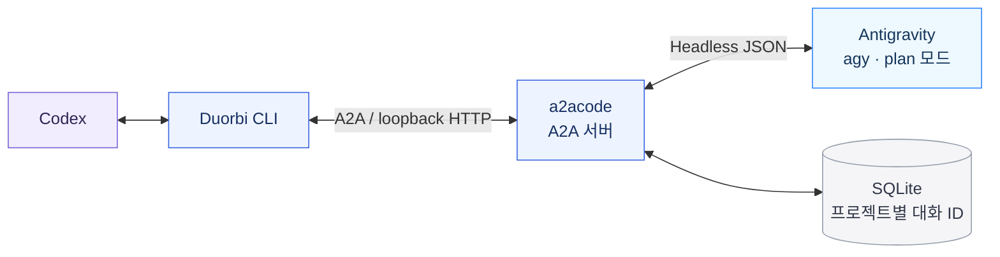

<p align="center">
  
</p>

# Duorbi · 듀오비

**두 에이전트, 계속 이어지는 대화.**

Codex가 주도하고 Antigravity가 설계 논의와 코드 검토에 참여하는 로컬 A2A 브리지입니다. 프로젝트별 대화 ID를 저장해 서버를 다시 시작해도 같은 논의를 이어갑니다.

[English](README.md) · [Codex 설정](docs/codex-integration.md) · [구조와 복원 원리](docs/architecture.md)



Antigravity가 문서로 제공하는 headless CLI를 사용합니다. 기존 데스크톱 채팅창 사이에 메시지를 보내는 기능은 없습니다. OpenAI·Google의 공식 제품이 아닌 독립 프로젝트입니다.

## 준비

- **0.1.0a1 macOS 시험판**, Python **3.13 이상**, [uv](https://docs.astral.sh/uv/).
- `PATH`에서 실행할 수 있는 Antigravity CLI `agy`. 원래 어댑터는 `agy 1.4.0`으로 실제 협업을 검증했습니다. 공개 패키지의 검증 범위는 [검증 문서](docs/verification.md)에 구분했습니다.
- 작업할 프로젝트에서 대화형 `agy`를 실행해 로그인을 먼저 완료합니다. Duorbi는 인증정보를 수집하거나 Antigravity를 설치하지 않습니다.
- Linux 실행은 아직 검증하지 않았습니다. POSIX 파일 잠금과 프로세스 그룹을 사용하므로 Windows 네이티브 실행은 지원하지 않습니다.

## 설치

저장소를 복제하고 폴더에서 실행합니다.

```sh
git clone https://github.com/genielabs-io/duorbi.git
cd duorbi
uv tool install --python 3.13 .
duorbi --version
duorbi --help
```

uv 도구 실행 경로가 터미널과 Codex 실행 환경의 `PATH`에 있어야 합니다. 전역 도구 설치 대신 이 폴더에서 `uv sync --frozen` 후 `uv run --frozen duorbi ...`를 사용해도 됩니다. 패키지 레지스트리 등록 없이 소스에서 설치할 수 있습니다.

## 첫 협업

첫 번째 터미널에서 실제 작업 대상 프로젝트를 지정해 서버를 시작합니다.

```sh
duorbi serve --project /absolute/path/to/project
```

두 번째 터미널에서 호출합니다.

```sh
duorbi status --project /absolute/path/to/project
duorbi call '이 설계를 검토해 줘. 파일은 수정하지 마.' --new --project /absolute/path/to/project
```

출력은 줄마다 하나의 JSON입니다. 마지막 `type: result`에 `response`, `state`, 성공 시 `context_id`와 `agent_session_id`가 들어 있습니다. **종료 코드 0이며 `state`가 `completed`인 경우만 성공**입니다. 실패·미완료는 2, upstream의 입력 대기 상태는 3이며 이 어댑터는 승인 응답을 중계하지 않습니다. 잘못된 CLI 문법은 argparse가 종료 코드 2로 처리합니다.

긴 프롬프트는 셸이 내용을 해석하지 않도록 파일로 전달하세요.

```sh
duorbi call - --new --project /absolute/path/to/project < review-request.txt
```

## 재시작·재부팅 후 이어가기

서버는 Ctrl+C로 종료합니다. 같은 프로젝트·저장소 설정으로 서버를 다시 시작한 뒤:

```sh
duorbi sessions --project /absolute/path/to/project
duorbi call '지난 논의를 이어가자.' --continue --project /absolute/path/to/project
```

| 옵션 | 동작 |
|---|---|
| `--continue` | 이 프로젝트에서 가장 최근 사용하거나 등록한 대화 복원 |
| `--context SAVED_CONTEXT_ID` | 저장된 특정 대화 복원 |
| `--new` 또는 선택 옵션 없음 | 새 대화 시작, 기존 기록 유지 |

기록이 없거나 복원할 수 없으면 오류를 반환합니다. 새 대화로 조용히 바꾸지 않습니다. Duorbi DB와 Antigravity 자체 대화 기록이 모두 남아 있어야 복원할 수 있습니다. 실행 중이던 작업·대기 중 승인을 복구하지는 않습니다. 프로젝트의 정규화된 절대경로가 바뀌면 다른 프로젝트로 취급합니다.

## Codex에서 자연어로 사용

[설정 안내](docs/codex-integration.md)에 따라 에이전트·지침 예제를 추가하면 다음처럼 요청할 수 있습니다.

> 제미나이한테 이 설계를 검토시켜 줘. 같은 대화에서 반론을 주고받고 네가 최종 판단해 줘.

> 제미나이와 이전 대화를 이어가 줘.

> 제미나이와 새 대화로 시작해 줘.

“제미나이”는 협업 별칭이며 실제로는 Antigravity `agy`를 호출합니다. Codex는 필요할 때 서버를 띄우고 작업이 끝나면 자신이 시작한 서버를 종료합니다. 로그인·부팅 시 자동 시작하는 서비스는 없습니다. 서버를 꺼도 완료된 대화 ID는 남습니다.

## 저장 위치와 실행 범위

macOS 기본 데이터베이스:

```text
~/Library/Application Support/Duorbi/conversations.sqlite3
```

다른 POSIX 시스템의 기본 폴더는 `$XDG_STATE_HOME/duorbi` 또는 `~/.local/state/duorbi`입니다. `DUORBI_STATE_DIR`, `--state-dir` 순으로 덮어쓸 수 있으며 명령 옵션이 우선합니다. 서버와 클라이언트에 같은 저장소를 지정하세요. `duorbi info --project PATH`로 실제 설정을 확인합니다.

DB에는 프로젝트 경로, 두 종류의 대화 ID, 시각만 저장합니다. 프롬프트·응답·인증정보는 저장하지 않습니다. Antigravity의 대화 본문은 Antigravity가 별도로 관리합니다. CLI 출력에는 답변이, 서버 로그에는 예외 정보가 포함될 수 있으므로 공유 전에 확인하세요.

서버는 인증을 설정하지 않은 `127.0.0.1` 주소에서 실행됩니다. 프로젝트·저장소 검사는 실수로 다른 곳에 연결되는 것을 막으며 인증을 대신하지 않습니다. 다른 로컬 프로세스도 접근할 수 있으므로 신뢰하는 개인 환경에서 사용하고 터널로 외부에 노출하지 마세요. `agy`는 현재 사용자 권한의 **plan 모드**로 실행되며 추가 OS 샌드박스·도구 승인 중계는 없습니다. 텍스트 분석과 검토에 사용하세요. 실제 `call`은 Antigravity의 일반 모델 사용량을 소비합니다.

## 개발과 테스트

```sh
uv sync --frozen
uv run --frozen python -m unittest discover -s tests -v
uv run --frozen python scripts/check_public.py
uv build
uv run --frozen python scripts/check_public.py --archives dist
```

테스트는 임시 DB와 가짜 `agy`로 로컬 HTTP·서버 재시작까지 확인하며 계정·모델 호출이 필요하지 않습니다. [기여 안내](CONTRIBUTING.md)

Duorbi는 [MIT](LICENSE), 별도 의존성인 [a2acode](https://github.com/kanywst/a2acode) 0.8.0은 Apache-2.0입니다. [출처와 의존성 고지](THIRD_PARTY_NOTICES.md)를 참고하세요.
