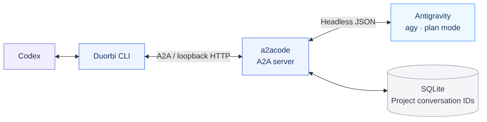

<p align="center">
  
</p>

# Duorbi

**Two agents. One continuing conversation.**

A local A2A bridge for Codex and Antigravity. Let Codex lead a design discussion or code review, ask the installed Antigravity CLI for another perspective, and resume that same conversation after restarting the bridge.

**Install with your coding agent**

Copy the prompt below and paste it into Codex:

```text
Read https://github.com/genielabs-io/duorbi/blob/main/INSTALL.md
and install Duorbi for this project with project-scoped Codex integration.
```

Your agent can follow [INSTALL.md](INSTALL.md) to check prerequisites, preserve existing settings, and verify the installation.

[한국어](README.ko.md) · [Agent installation](INSTALL.md) · [Codex setup](docs/codex-integration.md) · [Architecture](docs/architecture.md)



Duorbi uses Antigravity's documented headless CLI. It does not connect to existing Codex or Antigravity desktop chat windows. This is an independent community project.

## Status and requirements

- **macOS preview, installed from `main`.** The original adapter was exercised with Antigravity CLI `agy 1.4.0`. The extracted package is checked with fake CLI integration tests and a clean wheel installation; see [verification](docs/verification.md).
- Python **3.13+**, [uv](https://docs.astral.sh/uv/), and an installed `agy` executable on `PATH`.
- Authenticate using an interactive `agy` session in your project before making headless calls. Duorbi does not collect credentials or install Antigravity.
- Linux runtime compatibility has not been verified. Native Windows is unsupported; the adapter uses POSIX file locks and process groups.

## Install from this checkout

Clone the repository and enter its directory:

```sh
git clone --branch main https://github.com/genielabs-io/duorbi.git
cd duorbi
uv tool install --python 3.13 .
duorbi --version
duorbi --help
```

Ensure uv's tool executable directory is on your shell and Codex execution `PATH`. Alternatively, use the locked contributor environment: `uv sync --frozen`, followed by `uv run --frozen duorbi ...` from this checkout. No package-registry release is required for installation from source.

## First conversation

In terminal A, start a server for the actual project you want Antigravity to inspect:

```sh
duorbi serve --project /absolute/path/to/project
```

In terminal B:

```sh
duorbi status --project /absolute/path/to/project
duorbi call 'Review this design. Do not edit files.' --new --project /absolute/path/to/project
```

Output is newline-delimited JSON. The final `type: result` object includes `state`, `response`, `context_id` and `agent_session_id` when successful. Only **exit 0 and state `completed`** indicate success. Exit 2 indicates failure/incomplete work; exit 3 represents upstream input-required state, which this adapter cannot resolve through an approval relay. Invalid command syntax uses argparse's exit 2.

Read long prompts from stdin to avoid shell interpolation:

```sh
duorbi call - --new --project /absolute/path/to/project < review-request.txt
```

## Resume after restart

Stop your server with Ctrl+C. Start it again with the same project and state settings, then:

```sh
duorbi sessions --project /absolute/path/to/project
duorbi call 'Continue our previous discussion.' --continue --project /absolute/path/to/project
```

- `--continue` resumes the most recently used or imported conversation **for this project**.
- `--context SAVED_CONTEXT_ID` selects a specific saved conversation.
- `--new`, or a call without a selector, starts a new conversation and keeps older records.
- Missing or unavailable history produces an error. Duorbi never silently replaces a requested resume with a new conversation.

Completed conversation mappings survive process restarts and are stored on disk for use after a reboot. This requires both the Duorbi database and Antigravity's own conversation history. It does not recover interrupted tasks or pending approvals. Changing a project's canonical path creates a different project identity.

## Use with Codex

Install the optional [agent and instruction examples](docs/codex-integration.md), then ask:

> Ask Antigravity to review this design. Discuss the weak points in the same conversation, then make your own recommendation.

> Resume our previous Antigravity discussion for this project.

The examples support the Korean collaboration nickname “제미나이”. The target is always Antigravity `agy`; the nickname does not invoke Gemini CLI.

Codex starts a matching server when needed and stops servers it owns after the task. There is no login service or boot-time auto-start. Stopping a server preserves completed conversation IDs.

## Storage and boundaries

Default macOS database:

```text
~/Library/Application Support/Duorbi/conversations.sqlite3
```

Other POSIX systems use `$XDG_STATE_HOME/duorbi` or `~/.local/state/duorbi` as the state directory. Override with `DUORBI_STATE_DIR` or `--state-dir` (highest priority). Use the same directory on server and client commands. `duorbi info --project PATH` reports the resolved settings.

The database contains canonical project paths, A2A/agy conversation IDs and timestamps. It contains no prompts, answers or credentials. Antigravity stores its own history separately. CLI output contains answers, and server logs can include exception details; review them before sharing.

The server binds to `127.0.0.1` with no configured authentication. Project/store identity checks prevent accidental misrouting; they are not authentication. Other local processes may reach the endpoint. Use it on a trusted local machine and do not expose it with a tunnel. Antigravity runs as your OS user in **plan mode**, without an additional filesystem sandbox or a tool-approval relay. Keep assignments to text analysis and review. Each actual `call` uses Antigravity's normal model allowance.

## Development

```sh
uv sync --frozen
uv run --frozen python -m unittest discover -s tests -v
uv run --frozen python scripts/check_public.py
uv build
uv run --frozen python scripts/check_public.py --archives dist
```

Tests use temporary directories, SQLite and a fake `agy` executable, including real local HTTP and a full server restart. They require no account or model calls. See [CONTRIBUTING.md](CONTRIBUTING.md) for clean-wheel checks.

## License and dependencies

Duorbi code and documentation: [MIT](LICENSE). The A2A server is the separately installed **[a2acode](https://github.com/kanywst/a2acode) 0.8.0**, licensed under Apache-2.0. Upstream source is not vendored or modified. See [third-party notices](THIRD_PARTY_NOTICES.md).
